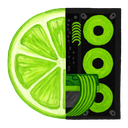

<p align="center">
  
</p>

<h1 align="center">Lalime</h1>

<p align="center"><strong>Your computer, done for you, safely.</strong><br/>
Made by <a href="https://lalime.com">Lalime</a>, makers of Lalime PC Repair</p>

Windows desktop app (Electron). Ask in plain English. Use ChatGPT through Codex, your own provider API key, or a local model. Guardian checks computer actions and asks for approval before changes. Undo is shown only when the backend supplies a restore operation.

Congressional App Challenge 2026 — **Jackson Price** (solo), TX-37.

There is **no demo mode** in the product. Each person supplies their own account or model. Lalime does not supply shared credentials or pay for model usage. API billing can be separate from a provider's chat subscription.

Settings include OpenAI, Anthropic, Gemini, Groq, Mistral, DeepSeek, OpenRouter, xAI, Together AI, Fireworks AI, Cerebras, Ollama, and a custom compatible endpoint. See [provider setup and limits](docs/PROVIDERS.md). Model IDs are editable. A successful request verifies access to the selected model; a catalog entry does not prove account entitlement.

Screen sharing and computer control start **off**. Settings also control instructions, tool limits, API output tokens, request timeout, and optional temperature. Primary API keys stay in main-process memory for the session. Saving settings clears the conversation view and requires reconnection.

Optional **better writing**: paste your own Anthropic API key in Settings. After Codex finishes a turn, Deliberate Lite on Claude Opus 5.5 rewrites the reply you see. Without a key (or on error), you get Codex’s text unchanged.

## Quick start (Windows — live agent)

Development requires Node.js 22.12 or later in a supported even-numbered release, plus the .NET 8 SDK to build the Windows helper. The installer includes the helper's .NET runtime.

```powershell
npm install
npm test
npm run build
npm run electron
```

1. Install Codex once: `npm i -g @openai/codex`
2. In Lalime onboarding, select **Sign in with ChatGPT** and finish in your browser. Lalime uses its own Codex account directory; it does not copy another app's login.
3. Or select the other-provider option, choose a provider in Settings, enter its model ID and your API key if needed, then connect. Direct API and local providers do not require Codex.
4. Ask a question. To use computer tools, first enable the required permissions in Settings, save, and reconnect. Approve each proposed change after reading its details.

A terminal `codex login` normally uses a different account directory. Use the in-app sign-in button to connect Lalime's isolated account.

```powershell
# optional overrides
$env:LALIME_CODEX_BIN = "codex"
$env:LALIME_MODEL = "gpt-5.4"
# Hands.exe is built by npm run build on Windows (.NET 8) and used by default.
```

Full AORUS checklist: [docs/WINDOWS_INSTALL.md](docs/WINDOWS_INSTALL.md)

## Develop

```bash
npm run build && npm run electron   # standalone (loads dist/)
npm run dev                         # Vite + Electron (LALIME_DEV=1)
npm run dev:renderer                # browser UI only — sign-in prompts; no live Codex
```

Hot reload: [http://127.0.0.1:43123](http://127.0.0.1:43123)

## What is live vs mocked

| Piece | Status |
|---|---|
| Product chat / agent | Codex or direct API/local provider (your credentials/model) |
| Guardian L1/L2 policy + tests | **Live** |
| Hands on Linux CI | **Mock / Node** (dev flag) |
| Hands.exe (screenshot, UIA, Recycle Bin) | **Default on Windows** — `npm run build` / `dist:win` produce it |
| Scripted chat fixtures | **Dev/CI only** via `LALIME_DEMO=1` — impossible in packaged builds |

## Windows installer

```powershell
pwsh scripts/build-windows-installer.ps1
# → release\Lalime-Setup-0.1.0.exe  (includes Hands.exe)
```

## Docs

- [docs/TESTING.md](docs/TESTING.md)
- [docs/WINDOWS_INSTALL.md](docs/WINDOWS_INSTALL.md)
- [docs/SUBMISSION_NOTES.md](docs/SUBMISSION_NOTES.md)
- [docs/JACKSON_TODO.md](docs/JACKSON_TODO.md)
- [docs/AI_DISCLOSURE.md](docs/AI_DISCLOSURE.md)
- [docs/ARCHITECTURE.md](docs/ARCHITECTURE.md)
- [docs/CONTRIBUTING.md](docs/CONTRIBUTING.md)
- [docs/SECURITY.md](docs/SECURITY.md)
- [docs/PROVIDERS.md](docs/PROVIDERS.md)

## Scripts

| Command | Purpose |
|---|---|
| `npm run build && npm run electron` | Standalone desktop app |
| `npm run dev` | Vite + Electron |
| `npm test` | Guardian, agent loop, path + secret scans |
| `npm run fixture:headless` | Dev-only scripted Guardian fixture (`LALIME_DEMO=1`) |
| `npm run test:ui` | Playwright smoke (sign-in onboarding) |
| `npm run dist:win` | NSIS installer (on Windows) |

## License

MIT — [LICENSE](LICENSE).
